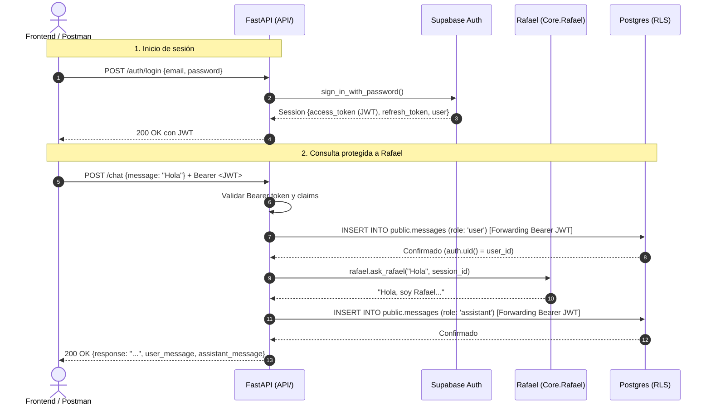

# Módulo `API`

> Documentación técnica del módulo REST de **Rafael** construido con **FastAPI** y conectado a **Supabase**.

---

## Índice

- [Visión general](#visión-general)
- [Estructura del módulo](#estructura-del-módulo)
- [Arquitectura y flujo de autenticación](#arquitectura-y-flujo-de-autenticación)
- [Seguridad y Row Level Security (RLS)](#seguridad-y-row-level-security-rls)
- [Configuración y variables de entorno](#configuración-y-variables-de-entorno)
- [Referencia de Endpoints](#referencia-de-endpoints)
  - [General](#general)
  - [Autenticación (`/auth`)](#autenticación-auth)
  - [Chat con Rafael (`/chat`, `/conversations/{id}/ask`)](#chat-con-rafael-chat-conversationsidask)
  - [Conversaciones (`/conversations`)](#conversaciones-conversations)
  - [Mensajes (`/messages`)](#mensajes-messages)
- [Dependencias e Inyección (`dependencies.py`)](#dependencias-e-inyección-dependenciespy)
- [Servicio Rafael (`rafael_service.py`)](#servicio-rafael-rafael_servicepy)
- [Esquemas Pydantic (`schemas/`)](#esquemas-pydantic-schemas)
- [Guía de ejecución y pruebas](#guía-de-ejecución-y-pruebas)

---

## Visión general

El paquete `API` provee una interfaz REST moderna, asíncrona y tipada con **FastAPI** que conecta a **Rafael** con **Supabase**, sustituyendo el almacenamiento local en archivos JSON por persistencia en la nube bajo políticas estrictas de aislamiento por usuario (**Row Level Security - RLS**).

### Principios de diseño
1. **Acceso exclusivo para usuarios autenticados**: Rafael solo atiende consultas de usuarios identificados mediante Supabase Auth.
2. **Aislamiento por RLS**: Las consultas y mutaciones en base de datos reenviarán el JWT del usuario, permitiendo que PostgreSQL filtre automáticamente las conversaciones y mensajes que pertenecen exclusivamente al llamante.
3. **Desacoplamiento arquitectónico**: No altera la lógica interna de `Core/` ni `Services/`, actuando como un consumidor limpio del método `ask_rafael` configurado en modo web (`use_tts=False`).

---

## Estructura del módulo

```
API/
├── __init__.py              # Metadatos del paquete
├── main.py                  # Punto de entrada de FastAPI, CORS y registro de routers
├── config.py                # Carga y validación de variables de entorno (.env) con Pydantic Settings
├── database.py              # Fábrica de clientes de Supabase (anónimos, autenticados y admin)
├── dependencies.py          # Inyección de dependencias (extracción de token, validación JWT, cliente RLS)
├── rafael_service.py        # Wrapper singleton de Rafael (use_tts=False)
├── requirements.txt         # Dependencias específicas de la API
├── schemas/                 # Validación y serialización con Pydantic
│   ├── __init__.py          # Exportación centralizada de esquemas
│   ├── auth.py              # Esquemas de login, verificación y usuario
│   ├── chat.py              # Esquemas para consultas y respuestas de IA
│   ├── conversation.py      # Esquemas de conversaciones (CRUD)
│   └── message.py           # Esquemas de mensajes (CRUD)
└── routers/                 # Endpoints organizados por dominio
    ├── __init__.py          # Exportación centralizada de routers
    ├── auth.py              # Endpoints de autenticación (/auth/login, /auth/verify, /auth/me)
    ├── chat.py              # Endpoints para interactuar con Rafael (/chat, /conversations/{id}/ask)
    ├── conversations.py     # Endpoints de gestión de conversaciones (/conversations)
    └── messages.py          # Endpoints de gestión de mensajes (/messages)
```

---

## Arquitectura y flujo de autenticación



---

## Seguridad y Row Level Security (RLS)

Supabase protege los datos a nivel de fila directamente en PostgreSQL:

* **Tabla `auth.users`**: Gestionada íntegramente por Supabase Auth.
* **Tabla `public.conversations`**:
  ```sql
  -- Columnas: id (uuid), user_id (uuid), title (text), created_at (timestamptz), updated_at (timestamptz)
  CREATE POLICY "Users can only view their own conversations" 
    ON public.conversations FOR SELECT USING (auth.uid() = user_id);
  ```
* **Tabla `public.messages`**:
  ```sql
  -- Columnas: id, conversation_id, role, content, tool_used, created_at
  CREATE POLICY "Users can only access messages from their conversations" 
    ON public.messages FOR ALL USING (
      EXISTS (SELECT 1 FROM public.conversations WHERE id = conversation_id AND user_id = auth.uid())
    );
  ```

### ¿Cómo garantiza la API el cumplimiento de RLS?
En `API/database.py`, la función `get_supabase_client(token=token)` inyecta el encabezado `Authorization: Bearer <token>` en el cliente PostgREST. De este modo, cada consulta ejecutada en nombre del usuario transmite sus credenciales criptográficas, forzando a Postgres a evaluar `auth.uid()` con la identidad del usuario real.

---

## Configuración y variables de entorno

La configuración se centraliza en `API/config.py` mediante `pydantic-settings`:

| Variable | Tipo | Obligatoria | Descripción |
|---|---|:---:|---|
| `SUPABASE_URL` | `str` | Sí | URL del proyecto Supabase (ej. `https://xxxx.supabase.co`) |
| `SUPABASE_PUBLISHABLE_KEY` | `str` | Sí* | Clave pública / anon de Supabase (`sb_publishable_...`) |
| `SUPABASE_ANON_KEY` | `str` | Sí* | Clave anónima alternativa |
| `SUPABASE_KEY` | `str` | Sí* | Clave genérica aceptada como fallback |
| `SUPABASE_JWT_SECRET` | `str` | No | Secreto JWT para decodificación criptográfica local opcional |
| `API_HOST` | `str` | No | Host de enlace (default: `0.0.0.0`) |
| `API_PORT` | `int` | No | Puerto de escucha (default: `8000`) |
| `CORS_ORIGINS` | `str / list` | No | Orígenes permitidos (default: `*`) |

*\* Al menos una de las claves públicas (`SUPABASE_PUBLISHABLE_KEY`, `SUPABASE_ANON_KEY` o `SUPABASE_KEY`) debe estar presente en `.env`.*

---

## Referencia de Endpoints

### General

#### `GET /`
Informa el estado del servicio y los enlaces a la documentación interactiva.

#### `GET /health`
Comprueba el estado de la API y si Supabase se encuentra configurado en las variables de entorno.

---

### Autenticación (`/auth`)

#### `POST /auth/login`
Inicia sesión con credenciales de Supabase Auth.
* **Cuerpo:**
  ```json
  {
    "email": "usuario@ejemplo.com",
    "password": "password_seguro"
  }
  ```
* **Respuesta (`200 OK`):**
  ```json
  {
    "access_token": "eyJhbGciOi...",
    "refresh_token": "...",
    "token_type": "bearer",
    "expires_in": 3600,
    "user": {
      "id": "11111111-2222-3333-4444-555555555555",
      "email": "usuario@ejemplo.com",
      "role": "authenticated"
    }
  }
  ```

#### `POST /auth/refresh`
Renueva un `access_token` vencido mediante el `refresh_token`.

#### `POST /auth/logout` *(Requiere Bearer Token)*
Finaliza la sesión del usuario.

#### `GET /auth/verify` *(Requiere Bearer Token)*
Valida la vigencia del token JWT contra Supabase Auth.

#### `GET /auth/me` *(Requiere Bearer Token)*
Obtiene los metadatos y perfil del usuario autenticado.

> [!NOTE]
> El endpoint `POST /auth/signup` se encuentra intencionalmente deshabilitado (`403 Forbidden`) para restringir la creación de cuentas no autorizadas.

---

### Chat con Rafael (`/chat`, `/conversations/{id}/ask`)

#### `POST /chat` *(Requiere Bearer Token)*
Endpoint directo y simplificado para enviar una pregunta a Rafael.
* **Comportamiento:**
  1. Si se omite `conversation_id`, crea automáticamente una nueva conversación en `public.conversations`.
  2. Registra el mensaje del usuario en `public.messages`.
  3. Ejecuta la inferencia con Rafael (`Core.Rafael.ask_rafael`).
  4. Registra la respuesta del asistente en `public.messages`.
* **Cuerpo:**
  ```json
  {
    "message": "¿Qué herramientas tienes disponibles?",
    "conversation_id": null
  }
  ```
* **Respuesta (`200 OK`):**
  ```json
  {
    "conversation_id": "99b2c3d4-...",
    "response": "Hola. Soy Rafael. Tengo búsqueda web y Spotify.",
    "user_message": { ... },
    "assistant_message": { ... }
  }
  ```

#### `POST /conversations/{conversation_id}/ask` *(Requiere Bearer Token)*
Envía una consulta dentro de una conversación ya existente. Valida bajo RLS que la conversación pertenezca al usuario antes de ejecutar a Rafael.

---

### Conversaciones (`/conversations`)

Todos los endpoints requieren `Authorization: Bearer <token>`:

| Método | Ruta | Descripción |
|---|---|---|
| `GET` | `/conversations` | Lista las conversaciones del usuario ordenadas por fecha reciente |
| `POST` | `/conversations` | Crea una nueva conversación (`{"title": "Nombre"}`) |
| `GET` | `/conversations/{id}` | Obtiene una conversación por ID (404 si no existe o pertenece a otro usuario) |
| `PATCH` | `/conversations/{id}` | Actualiza el título de una conversación |
| `DELETE` | `/conversations/{id}` | Elimina una conversación y sus mensajes asociados |

---

### Mensajes (`/messages`)

Todos los endpoints requieren `Authorization: Bearer <token>`:

| Método | Ruta | Descripción |
|---|---|---|
| `GET` | `/conversations/{conversation_id}/messages` | Lista cronológicamente todos los mensajes de una conversación |
| `POST` | `/conversations/{conversation_id}/messages` | Añade manualmente un mensaje (`role`, `content`, `tool_used`) |
| `GET` | `/messages/{message_id}` | Obtiene un mensaje individual por ID |
| `DELETE` | `/messages/{message_id}` | Elimina un mensaje por ID |

---

## Dependencias e Inyección (`dependencies.py`)

FastAPI inyecta de forma segura el contexto de cada solicitud:

```python
# 1. Extracción del token
token: str = Depends(get_token)

# 2. Validación de usuario contra Supabase Auth
current_user: dict = Depends(get_current_user)

# 3. Cliente de base de datos con scope RLS (Forwarding JWT)
client: Client = Depends(get_authenticated_client)
```

---

## Servicio Rafael (`rafael_service.py`)

Provee un patrón **Singleton con carga perezosa (lazy-loading)** de la clase `Rafael`:

```python
from API.rafael_service import get_rafael

rafael = get_rafael()
respuesta = rafael.ask_rafael("Hola", session_id="uuid-conversacion")
```

* Se inicializa con `use_tts=False` para evitar bloqueo por sintetizador de audio local en el servidor.
* Comparte la misma instancia del modelo Claude y del enrutador de herramientas `Administrator`.

---

## Guía de ejecución y pruebas

### 1. Activar el entorno virtual e instalar dependencias

```powershell
.\venv\Scripts\Activate.ps1
pip install -r API/requirements.txt
```

### 2. Ejecutar la API

```powershell
uvicorn API.main:app --reload --host 127.0.0.1 --port 8000
```

### 3. Explorar la documentación interactiva (Swagger UI)

Abre en tu navegador:
👉 **[http://localhost:8000/docs](http://localhost:8000/docs)**

Para autenticarte en Swagger:
1. Haz clic en el botón superior derecho **Authorize**.
2. Ingresa `Bearer <TU_ACCESS_TOKEN>` obtenido en `POST /auth/login`.
