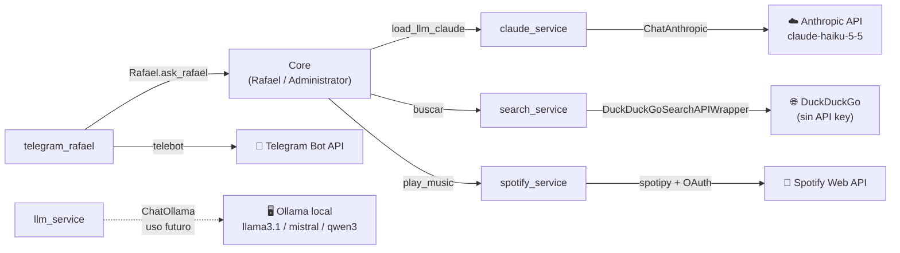

# Módulo `Services`

> Documentación técnica del paquete de servicios externos de **SystemCall**.

---

## Índice

- [Visión general](#visión-general)
- [Estructura del módulo](#estructura-del-módulo)
- [Arquitectura y dependencias](#arquitectura-y-dependencias)
- [Servicios LLM](#servicios-llm)
  - [claude\_service](#claude_service)
  - [llm\_service](#llm_service)
- [Servicios de herramientas](#servicios-de-herramientas)
  - [search\_service](#search_service)
  - [spotify\_service](#spotify_service)
- [Bots](#bots)
  - [telegram\_rafael](#telegram_rafael)
- [Variables de entorno requeridas](#variables-de-entorno-requeridas)
- [Comparativa de modelos LLM](#comparativa-de-modelos-llm)

---

## Visión general

El módulo `Services` actúa como **capa de integración** entre el núcleo de Rafael y los sistemas externos. Agrupa cuatro categorías de servicios:

| Categoría | Archivo(s) | Propósito |
|---|---|---|
| LLM en la nube | `claude_service.py` | Proveedor principal de IA (Anthropic Claude) |
| LLM local | `llm_service.py` | Modelos offline via Ollama (Llama, Mistral, Qwen) |
| Búsqueda web | `search_service.py` | Búsqueda en DuckDuckGo sin API key |
| Música | `spotify_service.py` | Control de reproducción en Spotify |
| Bots | `Bots/telegram_rafael.py` | Interfaz de Rafael en Telegram |

> [!NOTE]
> El `__init__.py` de `Services` está vacío — cada archivo debe importarse directamente por su ruta (ej: `from Services.claude_service import load_llm_claude`).

---

## Estructura del módulo

```
Services/
├── __init__.py              # Vacío (sin exportaciones automáticas)
├── claude_service.py        # Cliente LLM Anthropic Claude
├── llm_service.py           # Clientes LLM locales (Ollama)
├── search_service.py        # Motor de búsqueda web (DuckDuckGo)
├── spotify_service.py       # Control de reproducción Spotify
└── Bots/
    └── telegram_rafael.py   # Bot de Telegram
```

---

## Arquitectura y dependencias



---

## Servicios LLM

---

### `claude_service`

**Archivo:** [`claude_service.py`](../Services/claude_service.py)

Proveedor de LLM principal del sistema. Instancia el cliente de Anthropic Claude usando LangChain.

#### Función

```python
def load_llm_claude() -> ChatAnthropic
```

Retorna una instancia de `ChatAnthropic` lista para invocar.

**Parámetros de configuración:**

| Parámetro | Valor | Descripción |
|---|---|---|
| `model` | `claude-haiku-5-5` | Modelo rápido y económico de Anthropic |
| `max_tokens` | `1024` | Límite máximo de tokens en la respuesta |

**Uso:**

```python
from Services.claude_service import load_llm_claude

llm = load_llm_claude()
response = llm.invoke([SystemMessage(content="..."), HumanMessage(content="Hola")])
print(response.content)
```

> [!IMPORTANT]
> Este servicio requiere la variable de entorno `ANTHROPIC_API_KEY` definida en el archivo `.env`. Sin ella, `ChatAnthropic` lanzará un error de autenticación al momento de invocar.

**Usado por:** `Rafael` (respuestas conversacionales) y `Administrator` (decisiones de enrutamiento).

---

#### Roles de mensaje en LangChain

El docstring del archivo documenta el modelo de roles que usa LangChain con Claude:

| Rol | Clase | Función |
|---|---|---|
| `system` | `SystemMessage` | Define personalidad y reglas. Es el contexto más fuerte — equivale a "programar el cerebro" del modelo. |
| `user` | `HumanMessage` | Entrada del usuario en cada turno. |
| `assistant` | `AIMessage` | Salida anterior del asistente (historial). |

---

### `llm_service`

**Archivo:** [`llm_service.py`](../Services/llm_service.py)

Provee clientes LLM que se ejecutan **localmente** mediante [Ollama](https://ollama.com). No requieren conexión a internet ni API key una vez descargados los modelos.

#### Funciones

##### `load_llm_llama() → ChatOllama`

```python
from Services.llm_service import load_llm_llama
llm = load_llm_llama()
```

| Parámetro | Valor |
|---|---|
| `model` | `llama3.1:8b` |
| `temperature` | `0.7` |
| `top_p` | `0.95` |

---

##### `load_llm_mistral() → ChatOllama`

```python
from Services.llm_service import load_llm_mistral
llm = load_llm_mistral()
```

| Parámetro | Valor |
|---|---|
| `model` | `mistral:7b` |
| `temperature` | `0.7` |
| `top_p` | `0.95` |

---

##### `load_llm_qwen() → ChatOllama`

```python
from Services.llm_service import load_llm_qwen
llm = load_llm_qwen()
```

| Parámetro | Valor |
|---|---|
| `model` | `qwen3` |
| `temperature` | `0.7` |
| `top_p` | `0.95` |

---

> [!NOTE]
> Estas funciones están disponibles pero actualmente **comentadas en el código de Rafael y Administrator** (sustituidas por `load_llm_claude`). Se pueden reactivar como alternativa offline cambiando la línea de importación en `Core/Rafael.py` y `Core/Administrator.py`.

> [!TIP]
> Para usar modelos locales, instala Ollama y descarga el modelo deseado:
> ```bash
> ollama pull llama3.1:8b
> ollama pull mistral:7b
> ollama pull qwen3
> ```
> Luego reemplaza `load_llm_claude()` por la función local correspondiente.

---

## Servicios de herramientas

---

### `search_service`

**Archivo:** [`search_service.py`](../Services/search_service.py)

Motor de búsqueda web que usa **DuckDuckGo** (sin API key) para obtener información actualizada de internet y suministrarla como contexto al LLM.

#### Configuración global

```python
_search_wrapper = DuckDuckGoSearchAPIWrapper(
    max_results=5,
    region="co-es",       # Colombia en español
    safesearch="moderate",
    time=None,            # Sin filtro temporal
)
```

Esta instancia se crea una sola vez al importar el módulo (patrón singleton de módulo).

---

#### Función principal

##### `buscar(query: str) → str`

Realiza la búsqueda y retorna un texto formateado con los resultados, listo para ser inyectado en el prompt del LLM.

```python
from Services.search_service import buscar

contexto = buscar("clima en Bogotá hoy")
# → "RESULTADO 1\ntítulo: ...\nURL: ...\nInformacion: ..."
```

**Flujo interno:**

1. Valida que `query` no esté vacío.
2. Llama a `_search_wrapper.results(query, max_results=5)`.
3. Por cada resultado, extrae `title`, `link` y `snippet`.
4. Normaliza la URL con `_normalizar_url` y descarta duplicados usando un `set`.
5. Formatea los primeros 5 resultados únicos en texto estructurado.
6. Retorna el texto concatenado; en caso de error, retorna un mensaje de fallo.

**Formato de salida:**

```
RESULTADO 1
título: Título del artículo
URL: https://ejemplo.com/articulo
Informacion: Resumen del contenido...

RESULTADO 2
...
```

**Retornos especiales:**

| Situación | Retorno |
|---|---|
| `query` vacío o solo espacios | `"No se proporcionó un término de búsqueda."` |
| Sin resultados válidos | `"No se encontraron resultados relevantes."` |
| Error de red / API | `"No se pudo completar la búsqueda: <detalle del error>"` |

---

#### Funciones auxiliares (privadas)

##### `_generar_consultas(query: str) → list[str]`

Genera tres variantes de la consulta para ampliar cobertura:

```python
_generar_consultas("inteligencia artificial")
# → ["inteligencia artificial", "inteligencia artificial explicación", "inteligencia artificial documentación oficial"]
```

> [!NOTE]
> Esta función existe en el código pero actualmente **no se usa** en `buscar`. Solo se consulta la query original directamente. Fue diseñada para un modo multi-query que podría activarse en el futuro.

##### `_normalizar_url(url: str) → str`

Normaliza URLs eliminando parámetros de query y fragmentos para detectar duplicados:

```python
_normalizar_url("https://Ejemplo.com/page/?utm_source=google#section")
# → "https://ejemplo.com/page"
```

---

### `spotify_service`

**Archivo:** [`spotify_service.py`](../Services/spotify_service.py)

Controla la reproducción de Spotify mediante la **Spotify Web API** usando el flujo OAuth de [Spotipy](https://spotipy.readthedocs.io/).

#### Inicialización (módulo)

```python
sp = spotipy.Spotify(auth_manager=SpotifyOAuth(
    client_id=os.environ.get("CLIENT_ID_SPOTIFY"),
    client_secret=os.environ.get("CLIENT_SECRET_SPOTIFY"),
    redirect_uri="http://127.0.0.1:8888/callback",
    scope="user-modify-playback-state user-read-playback-state"
))
```

La autenticación OAuth se realiza al **importar el módulo**. En el primer uso, Spotipy abrirá el navegador para autorizar la aplicación y guardará el token en caché (`.cache`).

**Scopes de OAuth requeridos:**

| Scope | Permiso |
|---|---|
| `user-modify-playback-state` | Iniciar, pausar, cambiar canción |
| `user-read-playback-state` | Leer dispositivos activos y estado actual |

---

#### Función principal

##### `play_music(query: str) → str`

Busca una canción en Spotify y la reproduce en el dispositivo activo.

```python
from Services.spotify_service import play_music

resultado = play_music("Bohemian Rhapsody Queen")
# → "Reproduciendo: Bohemian Rhapsody - Queen en Spotify."
```

**Flujo interno:**

1. Busca la canción con `sp.search(q=query, limit=1, type='track')`.
2. Si no hay resultados: retorna mensaje de error.
3. Consulta los dispositivos activos con `sp.devices()`.
4. Si no hay dispositivos: retorna aviso para que el usuario abra Spotify.
5. Selecciona el primer dispositivo disponible y lanza la reproducción con `sp.start_playback`.
6. Retorna un mensaje de confirmación con el nombre de la canción y el artista.

**Retornos posibles:**

| Situación | Retorno |
|---|---|
| Reproducción exitosa | `"Reproduciendo: {nombre} - {artista} en Spotify."` |
| Sin dispositivos activos | `"No se pudo reproducir porque no hay dispositivos activos. Pídele al usuario que abra Spotify en su PC."` |
| Canción no encontrada | `"No se encontró ninguna canción en Spotify con ese nombre."` |

> [!IMPORTANT]
> **Spotify debe estar abierto** en algún dispositivo (PC, móvil, etc.) antes de llamar a `play_music`. La API de Spotify no puede iniciar el cliente por sí sola; solo puede controlar una sesión existente.

> [!WARNING]
> Las variables `CLIENT_ID_SPOTIFY` y `CLIENT_SECRET_SPOTIFY` deben estar definidas en `.env`. Si faltan, `SpotifyOAuth` lanzará un error al importar el módulo.

---

## Bots

### `telegram_rafael`

**Archivo:** [`Bots/telegram_rafael.py`](../Services/Bots/telegram_rafael.py)

Bot de Telegram que expone a **Rafael** como asistente de chat en la plataforma de mensajería. Cada conversación de Telegram mantiene su propio historial de sesión aislado.

#### Inicio del bot

```bash
# Desde la raíz del proyecto
python Services/Bots/telegram_rafael.py

# O usando el script de inicio rápido
iniciar_bot_telegram.bat
```

**Secuencia de arranque:**

1. Carga variables de entorno desde `.env`.
2. Instancia `Rafael(use_tts=False)` — TTS desactivado (canal de texto).
3. Crea el bot con `telebot.TeleBot(TELEGRAM_API_KEY)`.
4. Verifica la conexión con `bot.get_me()` y loguea el username del bot.
5. Inicia el polling infinito.

---

#### Handler de mensajes

##### `responder_usuario(message)`

Captura **todos los mensajes de texto** (`func=lambda message: True`) y los procesa con Rafael.

```python
@bot.message_handler(func=lambda message: True)
def responder_usuario(message):
    ...
```

| Campo Telegram | Uso en Rafael |
|---|---|
| `message.text` | Input de usuario (`user_input`) |
| `message.chat.id` | `session_id` — identifica y separa la memoria de cada usuario |

Cada usuario de Telegram tiene su propio historial persistido en `Memoria_Rafael/<chat_id>.json`, lo que permite conversaciones con contexto multi-turno.

**Manejo de errores:** Si Rafael lanza una excepción, el bot responde con un mensaje genérico de error y loguea el traceback completo.

---

#### Polling y reconexión automática

```python
while True:
    try:
        bot.infinity_polling(
            timeout=60,
            long_polling_timeout=60,
            skip_pending=True       # Ignora mensajes recibidos mientras el bot estaba offline
        )
    except Exception as e:
        logging.exception(f"Error en polling: {e}")
        time.sleep(10)             # Espera 10s antes de reintentar
```

El bucle `while True` garantiza **reconexión automática** ante fallos de red o errores del servidor de Telegram. `skip_pending=True` evita procesar una avalancha de mensajes acumulados al reiniciar.

---

## Variables de entorno requeridas

Todas las variables se definen en el archivo `.env` en la raíz del proyecto.

| Variable | Servicio | Obligatoria | Descripción |
|---|---|---|---|
| `ANTHROPIC_API_KEY` | `claude_service` | ✅ Sí | API key de Anthropic para acceder a Claude |
| `CLIENT_ID_SPOTIFY` | `spotify_service` | ✅ Sí | Client ID de la app de Spotify Developer |
| `CLIENT_SECRET_SPOTIFY` | `spotify_service` | ✅ Sí | Client Secret de la app de Spotify Developer |
| `TELEGRAM_API_KEY` | `telegram_rafael` | ✅ Sí (si se usa el bot) | Token del bot obtenido a través de @BotFather |

**Ejemplo de `.env`:**

```env
ANTHROPIC_API_KEY=sk-ant-...
CLIENT_ID_SPOTIFY=abc123...
CLIENT_SECRET_SPOTIFY=def456...
TELEGRAM_API_KEY=7891234567:AAF...
```

> [!CAUTION]
> Nunca subas el archivo `.env` a un repositorio público. Verifica que `.gitignore` lo excluya. La exposición de estas claves puede generar cargos económicos no autorizados (Anthropic, Spotify) o comprometer la seguridad del bot.

---

## Comparativa de modelos LLM

| Modelo | Servicio | Tipo | Velocidad | Privacidad | Costo | Estado actual |
|---|---|---|---|---|---|---|
| `claude-haiku-5-5` | `claude_service` | Nube | ⚡ Muy alta | Datos enviados a Anthropic | De pago (por token) | ✅ **Activo** |
| `llama3.1:8b` | `llm_service` | Local | 🐢 Media (CPU) | 🔒 Total (sin salida de datos) | Gratis | ⏸ Comentado |
| `mistral:7b` | `llm_service` | Local | 🐢 Media (CPU) | 🔒 Total | Gratis | ⏸ Comentado |
| `qwen3` | `llm_service` | Local | 🐢 Media (CPU) | 🔒 Total | Gratis | ⏸ Comentado |

> [!TIP]
> Para cambiar de Claude a un modelo local, edita estas dos líneas en `Core/Rafael.py` y `Core/Administrator.py`:
> ```python
> # Antes (nube):
> from Services.claude_service import load_llm_claude
> self.llm = load_llm_claude()
>
> # Después (local):
> from Services.llm_service import load_llm_llama
> self.llm = load_llm_llama()
> ```
