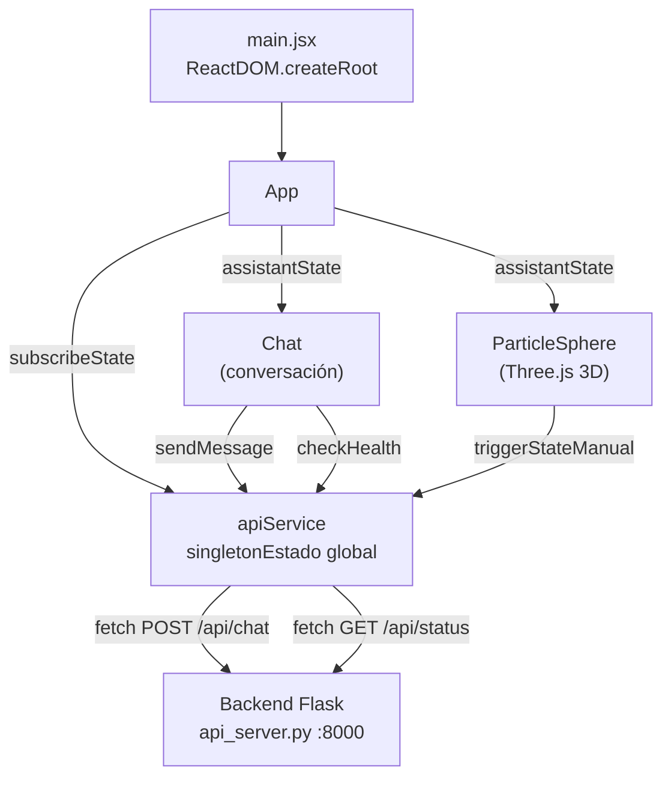

# Módulo `UI`

> Documentación técnica del frontend de **SystemCall** — interfaz web de Rafael.

---

## Índice

- [Visión general](#visión-general)
- [Estructura del módulo](#estructura-del-módulo)
- [Stack tecnológico](#stack-tecnológico)
- [Arquitectura de componentes](#arquitectura-de-componentes)
- [Estados del asistente](#estados-del-asistente)
- [Archivos raíz](#archivos-raíz)
  - [index.html](#indexhtml)
  - [main.jsx](#mainjsx)
  - [App.jsx](#appjsx)
- [Sistema de diseño](#sistema-de-diseño)
- [Componentes](#componentes)
  - [ParticleSphere](#particlesphere)
  - [Chat](#chat)
- [Servicio de API](#servicio-de-api)
- [Responsive y Mobile](#responsive-y-mobile)
- [Configuración de Vite](#configuración-de-vite)
- [Comandos de desarrollo](#comandos-de-desarrollo)

---

## Visión general

La UI de SystemCall es una **Single Page Application (SPA)** construida con React 18 y Vite. Presenta a Rafael a través de dos zonas simultáneas:

- **Zona izquierda (60%):** Visualización 3D del núcleo neuronal de Rafael — una esfera de partículas animada con Three.js que reacciona en tiempo real al estado del asistente.
- **Zona derecha (40%):** Interfaz de chat conversacional con historial de mensajes, indicadores de estado y configuración del backend.

Ambas zonas se sincronizan mediante un **servicio de estado centralizado** (`apiService`) sin prop-drilling profundo.

---

## Estructura del módulo

```
UI/
├── index.html                          # Punto de entrada HTML
├── vite.config.js                      # Configuración de Vite
├── package.json                        # Dependencias y scripts
└── src/
    ├── main.jsx                        # Montaje de React en el DOM
    ├── App.jsx                         # Layout principal + navegación móvil
    ├── App.css                         # Layout de zonas y responsive
    ├── index.css                       # Variables globales, reset, animaciones
    ├── components/
    │   ├── ParticleSphere/
    │   │   ├── ParticleSphere.jsx      # Esfera 3D de partículas (Three.js)
    │   │   └── ParticleSphere.css      # HUD overlay + badges de estado
    │   └── Chat/
    │       ├── Chat.jsx                # Interfaz de chat conversacional
    │       └── Chat.css                # Estilos del chat
    └── services/
        └── apiService.js              # Cliente HTTP + máquina de estados
```

---

## Stack tecnológico

| Tecnología | Versión | Rol |
|---|---|---|
| React | `^18.3.1` | Framework de UI y gestión de estado local |
| Vite | `^6.0.0` | Bundler + servidor de desarrollo con HMR |
| Three.js | `^0.170.0` | Motor 3D WebGL para la esfera de partículas |
| lucide-react | `^0.460.0` | Librería de iconos SVG (Bot, Send, Settings, etc.) |
| `@vitejs/plugin-react` | `^4.3.4` | Soporte JSX + Fast Refresh para Vite |

---

## Arquitectura de componentes



> [!NOTE]
> `apiService` es un **singleton de módulo** (instancia exportada). Todos los componentes que lo importan comparten el mismo objeto, lo que lo convierte en el bus de estado global sin necesidad de Context API ni Redux.

---

## Estados del asistente

La máquina de estados de la UI tiene **5 estados** definidos en `ASSISTANT_STATES`:

| Estado | Valor | Cuándo ocurre |
|---|---|---|
| `IDLE` | `'IDLE'` | Reposo — esperando input del usuario |
| `LISTENING` | `'LISTENING'` | Mensaje enviado, esperando procesamiento (300 ms) |
| `THINKING` | `'THINKING'` | Petición HTTP en curso al backend |
| `RESPONDING` | `'RESPONDING'` | Respuesta recibida, animando la entrega |
| `ERROR` | `'ERROR'` | Fallo de red o error HTTP del backend |

**Transición de estados en `sendMessage`:**

```
IDLE → LISTENING (300ms) → THINKING → RESPONDING → IDLE
                                    ↘ ERROR (3s) → IDLE
```

La duración del estado `RESPONDING` es proporcional a la longitud de la respuesta:

```js
const animDuration = Math.min(Math.max(aiResponse.length * 20, 1800), 4500);
// Mínimo: 1.8s | Máximo: 4.5s
```

**Efecto visual por estado en la esfera:**

| Estado | Velocidad orbital | Concentración | Pulso | Color especial |
|---|---|---|---|---|
| `IDLE` | 0 (fija) | 1.0 | Lento, respiración (1.35 Hz) | — |
| `LISTENING` | 0.9 | +8% (expansión) | Medio (3.5 Hz) | — |
| `THINKING` | 2.4 (máxima) | -28% (implosión) | Rápido (6 Hz) | — |
| `RESPONDING` | 1.2 | +15% (explosión) | Ondas radiales (4.2 Hz) | — |
| `ERROR` | 0 | 1.0 | Glitch vibratorio (8 Hz) | Naranja ámbar |

---

## Archivos raíz

### `index.html`

Punto de entrada del documento HTML. Define:

- **Favicon:** SVG inline de un círculo verde neón con símbolo play.
- **Título:** `Rafael AI – Asistente Inteligente`
- **Fuentes de Google Fonts** (con `preconnect` para rendimiento):
  - `Inter` (300–700) — tipografía principal para texto de interfaz
  - `JetBrains Mono` (400–700) — tipografía monoespaciada para badges, timestamps y código
  - `Orbitron` (500–900) — tipografía HUD para títulos y nombres

---

### `main.jsx`

Punto de montaje de React. Renderiza `<App />` dentro de `React.StrictMode` en el elemento `#root`.

```jsx
ReactDOM.createRoot(document.getElementById('root')).render(
  <React.StrictMode>
    <App />
  </React.StrictMode>
);
```

> [!NOTE]
> `React.StrictMode` activa validaciones adicionales en desarrollo (efectos dobles, renders dobles). No afecta el build de producción.

---

### `App.jsx`

Componente raíz. Gestiona:

1. **Suscripción al estado global** del asistente via `apiService.subscribeState`.
2. **Layout de dos zonas** en escritorio (60/40).
3. **Navegación móvil** con toggle entre `'sphere'`, `'chat'` o `'both'`.

**Estado local:**

| Estado | Tipo | Propósito |
|---|---|---|
| `assistantState` | `string` | Estado actual del asistente, recibido del `apiService` |
| `activeMobileTab` | `string` | Tab activo en móvil: `'both'` / `'sphere'` / `'chat'` |

**Props pasadas a hijos:**

| Prop | Destino | Tipo |
|---|---|---|
| `assistantState` | `ParticleSphere` | `string` |
| `assistantState` | `Chat` | `string` |

---

## Sistema de diseño

Toda la paleta, tipografía y efectos visuales se definen como **CSS Custom Properties** en `index.css`:

### Paleta de color

| Variable | Valor | Uso |
|---|---|---|
| `--bg-primary` | `#030712` | Fondo principal (negro profundo) |
| `--bg-secondary` | `#080f1d` | Fondo del panel de chat |
| `--bg-panel` | `rgba(11,20,38,0.75)` | Paneles con glassmorphism |
| `--neon-green` | `#00ff88` | Color de acento principal |
| `--neon-green-glow` | `rgba(0,255,136,0.35)` | Halo de brillo verde |
| `--emerald-green` | `#059669` | Botones de acción |
| `--electric-yellow` | `#facc15` | Badge de búsqueda web |
| `--warning-amber` | `#f97316` | Estado ERROR |
| `--error-red` | `#ef4444` | Indicador offline / mensajes de error |
| `--text-main` | `#f3f4f6` | Texto principal |
| `--text-muted` | `#94a3b8` | Texto secundario |
| `--text-dim` | `#64748b` | Texto desvanecido / timestamps |
| `--border-glass` | `rgba(0,255,136,0.18)` | Bordes con tinte verde |
| `--border-glass-dim` | `rgba(255,255,255,0.08)` | Bordes sutiles |

### Tipografías

| Variable | Fuente | Uso |
|---|---|---|
| `--font-sans` | Inter | Texto de UI general |
| `--font-mono` | JetBrains Mono | Badges, timestamps, código, inputs |
| `--font-hud` | Orbitron | Títulos HUD, nombre del agente |

### Clases de utilidad

| Clase | Efecto |
|---|---|
| `.glass-panel` | Fondo semitransparente + `backdrop-filter: blur(16px)` + borde sutil |
| `.glass-panel-glow` | Igual que `.glass-panel` + sombra verde neón difusa |
| `.animate-pulse-neon` | Animación `neonPulse` — pulso de brillo verde cada 2.5s |
| `.animate-float` | Animación `floatSoft` — flotación vertical suave cada 4s |

### Animaciones globales

| Nombre | Descripción |
|---|---|
| `neonPulse` | Pulso de box-shadow verde neón (0.3 → 0.6 opacidad) |
| `scanline` | Línea de escaneo que recorre verticalmente (efecto CRT) |
| `floatSoft` | Desplazamiento vertical de 6px hacia arriba y regreso |

---

## Componentes

---

### `ParticleSphere`

**Archivo:** [`src/components/ParticleSphere/ParticleSphere.jsx`](../UI/src/components/ParticleSphere/ParticleSphere.jsx)

Componente de visualización 3D que representa el "núcleo neuronal" de Rafael. Renderiza un sistema de partículas interactivo con Three.js cuyo comportamiento cambia según el estado del asistente.

#### Props

| Prop | Tipo | Descripción |
|---|---|---|
| `assistantState` | `string` | Estado actual del asistente (`ASSISTANT_STATES.*`) |

#### Inicialización Three.js (dentro de `useEffect`)

La escena Three.js se construye una sola vez al montar el componente:

**Escena:**
- `FogExp2` con densidad `0.0018` — crea profundidad atmosférica
- Fondo CSS: gradiente radial oscuro azul-negro

**Cámara:**
- `PerspectiveCamera` con FOV `55°`, posición `z = 120`
- Ajuste dinámico de aspect ratio en resize

**Renderer:**
- `WebGLRenderer` con `antialias: true`, `alpha: true`
- `pixelRatio` limitado a `2` para rendimiento
- Clear color: `#020617`

---

#### Sistema de partículas

**Total:** `1000 partículas` distribuidas en 3 capas:

| Capa | % | Radio | Color |
|---|---|---|---|
| Núcleo central | 15% | 4–10 unidades | Amarillo (`#facc15`) + Lima (`#ccff00`) |
| Manto neural | 20% | 11–20 unidades | Verde neón (`#00ff88`) + Lima |
| Corteza exterior | 65% | 22–25 unidades | Esmeralda (`#059669`) + Verde neón |

Cada partícula tiene atributos físicos individuales:
- `phiAngles` / `thetaAngles` — posición en coordenadas esféricas
- `speeds` — velocidad orbital (positiva o negativa, distribución ±)
- `isDetached` (10%) — partículas con comportamiento de "destello coronal" que oscilan hacia afuera y regresan
- `detachMaxDist` — distancia máxima de separación (1–3 unidades)

**Textura de partícula:** generada programáticamente con `Canvas 2D API` — gradiente radial blanco → verde neón → esmeralda → transparente, sin carga de archivos externos.

**Material:** `THREE.PointsMaterial` con `AdditiveBlending` para efecto de luz acumulativa y `depthWrite: false` para transparencia correcta entre partículas.

---

#### Loop de animación

Ejecutado con `requestAnimationFrame` a 60 fps. En cada frame:

1. **Parallax de mouse:** La esfera sigue el cursor con interpolación suave (factor `0.05`), rotando en X e Y.
2. **Modulación de estado:** Según `stateRef.current`, se actualizan los parámetros objetivo mediante lerp (`factor 0.06`):
   - Velocidad orbital (`currentOrbitSpeed`)
   - Concentración (`currentConcentration`) — escala global de radios
   - Frecuencia y amplitud de pulso senoidal
3. **Pulsación orgánica:** `currentPulseScale = currentConcentration × (1 + sin(t × pulseFreq) × pulseAmplitude)`
4. **Ondas radiales:** En `RESPONDING` e `IDLE`, se suma una onda de desplazamiento radial `sin(r × 0.3 − waveOffset)` que viaja desde el núcleo hacia la periferia.
5. **Glitch en ERROR:** Las partículas reciben un desplazamiento aleatorio de ±0.9 cada frame.
6. **Transición de color en ERROR:** Interpolación (`lerp`) progresiva de todos los colores de partículas hacia naranja ámbar (`#f97316`) y regreso automático.
7. **Respiración de opacidad:** `material.opacity = 0.82 + sin(t × pulseFreq) × 0.12`

---

#### HUD overlay

Superpuesto sobre el canvas con `position: absolute`:

**HUD superior** (`sphere-hud-header`):
- Izquierda: etiqueta `NÚCLEO NEURONAL` + título `RAFAEL` (fuente Orbitron)
- Derecha: **State Pill** — badge dinámico con punto pulsante y texto del estado

**HUD inferior** (`sphere-hud-footer`):
- Botonera de test de estados — permite cambiar manualmente entre los 5 estados para previsualizar la animación. Se oculta automáticamente en pantallas < 900px.

**Badges de estado:**

| Estado | Etiqueta | Color |
|---|---|---|
| `IDLE` | `EN REPOSO` | Verde neón |
| `LISTENING` | `ESCUCHANDO` | Amarillo eléctrico |
| `THINKING` | `PROCESANDO...` | Lima (`#ccff00`) |
| `RESPONDING` | `RESPONDIENDO` | Verde neón brillante |
| `ERROR` | `ALERTA / ERROR` | Naranja ámbar |

---

#### Cleanup

El `useEffect` retorna una función de limpieza que cancela el `requestAnimationFrame`, elimina los event listeners, dispone todos los recursos de Three.js (`renderer`, `geometry`, `material`, `texture`) y elimina el canvas del DOM. Evita memory leaks en hot-reloads y desmontajes.

---

### `Chat`

**Archivo:** [`src/components/Chat/Chat.jsx`](../UI/src/components/Chat/Chat.jsx)

Interfaz de conversación entre el usuario y Rafael. Gestiona el historial de mensajes, la conexión con el backend, y muestra indicadores visuales de estado.

#### Props

| Prop | Tipo | Descripción |
|---|---|---|
| `assistantState` | `string` | Estado actual — controla el indicador de escritura |

#### Estado local

| State | Tipo | Valor inicial | Descripción |
|---|---|---|---|
| `messages` | `array` | `[]` | Historial de mensajes del chat |
| `input` | `string` | `''` | Texto del input del usuario |
| `isSending` | `bool` | `false` | Bloqueo de UI durante el envío |
| `isBackendOnline` | `bool` | `false` | Estado de conexión con el backend |
| `showSettings` | `bool` | `false` | Visibilidad del drawer de configuración |
| `customApiUrl` | `string` | URL guardada en `localStorage` | URL del backend en edición |
| `settingsStatus` | `string\|null` | `null` | Feedback del intento de conexión |

#### Refs

| Ref | Uso |
|---|---|
| `messagesEndRef` | Ancla de scroll — `.scrollIntoView({ behavior: 'smooth' })` al recibir mensajes |
| `inputRef` | Re-enfoca el textarea automáticamente tras enviar un mensaje |

---

#### Efectos (`useEffect`)

**Health check periódico:**

```js
const interval = setInterval(checkConnection, 8000);
```

Verifica la conexión con el backend cada **8 segundos** llamando a `apiService.checkHealth()`. Actualiza el indicador online/offline en la cabecera.

**Scroll automático:**

Se ejecuta tras cada cambio en `messages` o `assistantState` para mantener el scroll en el último mensaje.

---

#### Funciones principales

##### `handleSend(textToSend?)`

Envía un mensaje al backend y agrega las respuestas al historial.

```
1. Validar input no vacío y no en envío
2. Limpiar textarea y bloquear UI
3. Crear mensaje de usuario con timestamp
4. Llamar apiService.sendMessage(query)
5a. Éxito → crear mensaje de Rafael con tool badge si aplica
5b. Error → crear mensaje de error con estilo especial
6. Desbloquear UI y re-enfocar textarea
```

**Estructura de un mensaje:**

```js
{
  id: Date.now(),         // ID único
  sender: 'user' | 'rafael',
  text: string,
  time: string,           // "HH:MM"
  tool: 'search' | 'spotify' | null,  // Solo en mensajes de Rafael
  isError: boolean        // Solo en mensajes de error
}
```

##### `handleKeyDown(e)`

Envía el mensaje al presionar `Enter` sin `Shift`. `Shift+Enter` inserta salto de línea.

##### `handleSaveApiUrl()`

Guarda la URL personalizada del backend via `apiService.setApiUrl()`, que la persiste en `localStorage` y verifica la conexión inmediatamente.

---

#### Estructura visual del Chat

```
┌─────────────────────────────────────────────┐
│ [Avatar] Rafael   AI ASSISTANT  [🔄] [⚙️]  │  ← chat-header
│          ● Conectado al servidor              │
├─────────────────────────────────────────────┤
│ [Settings Drawer - condicional]              │  ← settings-drawer
├─────────────────────────────────────────────┤
│                                              │
│  [🤖] Rafael                        10:30   │  ← bubble-rafael
│       Hola, soy Rafael...                   │
│                                              │
│                        10:31  [👤] Tú       │  ← bubble-user
│               ¿Qué tiempo hace hoy?         │
│                                              │
│  [🤖] Rafael  🌐 Búsqueda Web      10:31   │
│       Hoy en Bogotá está nublado...         │
│                                              │
│  [🤖] ● ● ●  Rafael está procesando...     │  ← typing-bubble
│                                              │
├─────────────────────────────────────────────┤
│ [textarea ___________________________] [➤]  │  ← chat-input-area
└─────────────────────────────────────────────┘
```

#### Tool badges en mensajes

Cuando Rafael usa una herramienta, el mensaje incluye un badge visual:

| `tool` | Badge | Color |
|---|---|---|
| `search` | 🔍 Búsqueda Web | Amarillo eléctrico |
| `spotify` | 🎵 Spotify | Verde Spotify (`#1ed760`) |
| `null` | (sin badge) | — |

#### Indicador de escritura

Se muestra cuando `assistantState === ASSISTANT_STATES.THINKING`:

```jsx
<div className="typing-bubble">
  <span className="typing-dot dot-1" />  {/* animDelay: 0s   */}
  <span className="typing-dot dot-2" />  {/* animDelay: 0.2s */}
  <span className="typing-dot dot-3" />  {/* animDelay: 0.4s */}
  <span className="typing-text">Rafael está procesando...</span>
</div>
```

Tres puntos verdes con animación `typingBounce` escalonada (0.2s entre cada uno).

---

## Servicio de API

**Archivo:** [`src/services/apiService.js`](../UI/src/services/apiService.js)

Clase `ApiService` instanciada como singleton de módulo. Centraliza la comunicación HTTP y la máquina de estados de la UI.

### Configuración

| Parámetro | Valor por defecto | Almacenamiento |
|---|---|---|
| `apiUrl` | `http://localhost:8000` | `localStorage['rafael_api_url']` |
| `currentState` | `ASSISTANT_STATES.IDLE` | En memoria |
| `isBackendAvailable` | `false` | En memoria |

La URL del backend es **configurable y persistente**: el usuario puede cambiarla desde la UI y se guarda en `localStorage`.

---

### Métodos

#### `subscribeState(callback) → unsubscribeFn`

Registra un listener que se llama cada vez que el estado cambia. Retorna una función para cancelar la suscripción.

```js
const unsubscribe = apiService.subscribeState((state) => {
  console.log('Nuevo estado:', state);
});
// Para cancelar:
unsubscribe();
```

> Llama al callback inmediatamente con el estado actual al suscribirse.

---

#### `checkHealth() → Promise<boolean>`

Ping al endpoint `/api/status` con timeout de **2 segundos** vía `AbortController`. Retorna `true` si el servidor responde `200 OK`.

---

#### `sendMessage(text, sessionId?) → Promise<{ text, tool }>`

Envío principal. Gestiona la transición completa de estados y retorna la respuesta de Rafael.

```js
const result = await apiService.sendMessage("¿Qué es React?", "mi_sesion");
// result.text → "React es una librería..."
// result.tool → null | "search" | "spotify"
```

**Timeout:** 30 segundos (para acomodar búsquedas web + inferencia LLM).

**Payload enviado:**

```json
{ "message": "texto del usuario", "session_id": "web_user" }
```

**Respuesta esperada del backend:**

```json
{ "response": "texto de Rafael", "status": "ok" }
```

---

#### `setApiUrl(newUrl) → Promise<boolean>`

Actualiza la URL del backend, la persiste en `localStorage` y ejecuta un health check inmediato.

```js
await apiService.setApiUrl("https://mi-backend.fly.dev");
```

---

#### `triggerStateManual(stateName)`

Fuerza un cambio de estado manualmente. Usado por los botones de test en la esfera:

```js
apiService.triggerStateManual('THINKING');
```

---

## Responsive y Mobile

El layout se adapta a pantallas < 960px:

| Breakpoint | Comportamiento |
|---|---|
| > 960px (escritorio) | Layout horizontal: esfera 60% izquierda, chat 40% derecha |
| ≤ 960px (tablet/móvil) | Layout vertical: cada zona ocupa 50% de altura; aparece el toggle de navegación |

**Toggle móvil** (esquina superior derecha):
- **"Esfera 3D"** — muestra solo la zona de la esfera (chat oculto)
- **"Chat"** — muestra solo el chat (esfera oculta)
- El zona visible toma `flex: 1 1 100%; height: 100%` automáticamente

Los botones de test de estados en la esfera se **ocultan** en pantallas < 900px para ahorrar espacio.

---

## Configuración de Vite

**Archivo:** [`vite.config.js`](../UI/vite.config.js)

```js
export default defineConfig({
  plugins: [react()],
  base: './',          // Rutas relativas — funciona en localhost y en subdirectorios de GitHub Pages
  server: {
    port: 3000,
    open: true,        // Abre el navegador automáticamente al iniciar
  },
  build: {
    outDir: 'dist',
    assetsDir: 'assets',
    sourcemap: false,  // Desactivados en producción
  },
});
```

> [!IMPORTANT]
> `base: './'` es fundamental para que el build de producción funcione tanto en rutas absolutas (`/`) como en subdirectorios (`/SystemCall/`), como ocurre en GitHub Pages.

---

## Comandos de desarrollo

Ejecutar desde el directorio `UI/`:

```bash
# Instalar dependencias
pnpm install       # o npm install

# Servidor de desarrollo con HMR en http://localhost:3000
pnpm dev

# Build de producción (salida en UI/dist/)
pnpm build

# Previsualizar el build de producción localmente
pnpm preview
```

O desde la raíz del proyecto usando el script de inicio rápido:

```bat
iniciar_ui.bat
```

> [!TIP]
> El frontend requiere que el backend Python (`api_server.py`) esté corriendo en `http://localhost:8000` para funcionar. Si el backend no está disponible, la UI lo detecta automáticamente y muestra el indicador de conexión en rojo, pero sigue cargando.
